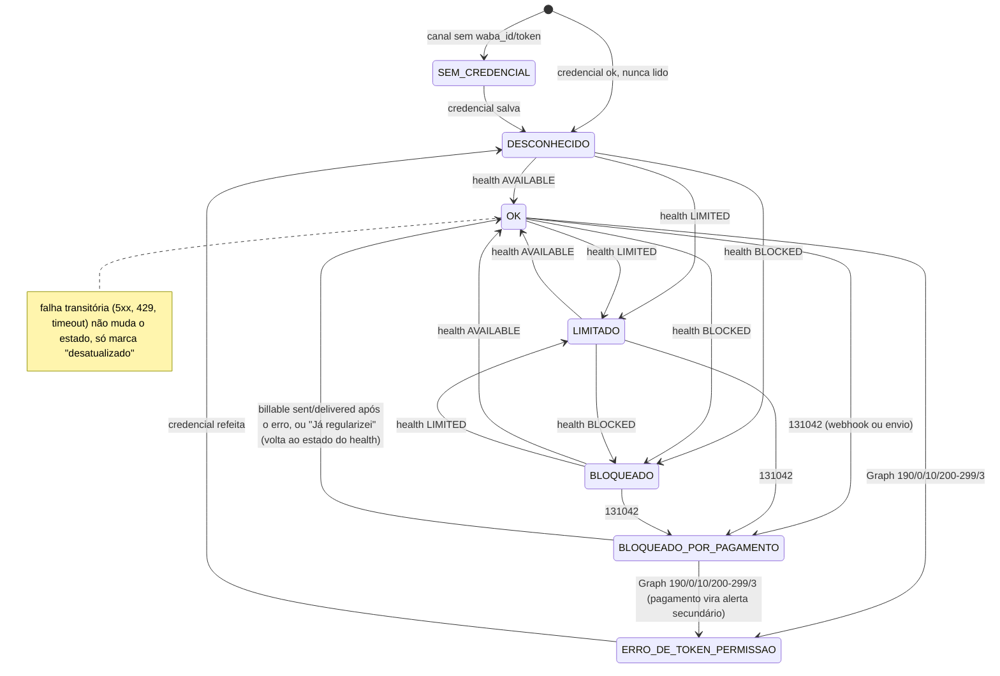
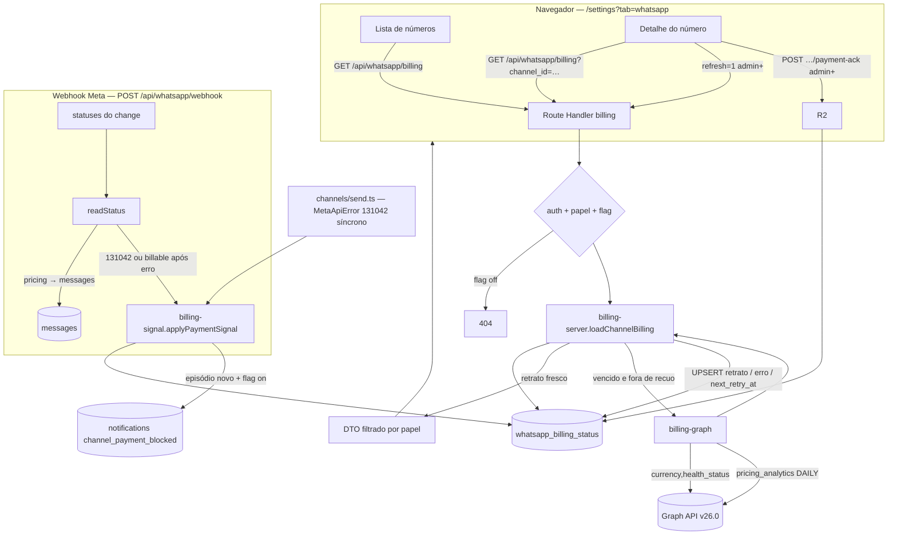

# SPEC 076 — Monitor de status de envio e consumo do WhatsApp Cloud API

| Campo            | Valor                                                                                                                                                                                                                                   |
| ---------------- | --------------------------------------------------------------------------------------------------------------------------------------------------------------------------------------------------------------------------------------- |
| Status           | **Proposta**: aguarda ratificação das decisões D-1…D-12 (§4.3) e a execução do Plano de validação (§14) com conta real                                                                                                                  |
| PRD              | Nenhum. A SPEC parte de um pedido direto do mantenedor e da pesquisa de 01/10/2026 (Graph API Explorer v26.0 + documentação da Meta)                                                                                                    |
| Escopo           | Monitor **somente leitura**, por canal `whatsapp_cloud`: **Status de envio** (com motivo), **Consumo estimado no mês** por categoria na moeda do WABA e **alerta de bloqueio por pagamento** (erro 131042), na aba "WhatsApp Oficial"   |
| Fora de escopo   | Recarga/"adicionar saldo"; carteira ou ledger próprio de créditos; virar Tech Provider/BSP; ler o "Saldo atual" do Billing Hub; instâncias QRCode (Evolution GO) (§3.2)                                                                  |
| Depende de       | SPEC 044 (cache persistido do tier: o precedente de cache deste monitor), SPEC 048/049 (camada de canais), SPEC 064 (N números oficiais, `resolveCloudConfig`, `channels.status`), SPEC 067 (`MetaApiError`), SPEC 075 (registro de atividade, opcional) |
| Migração         | **086** (proposta): `whatsapp_billing_status`, duas colunas em `messages`, um tipo novo em `notifications`, flag em `platform_settings` (§8). Confirmar `vn`/`rs` com o mantenedor antes de aplicar                                     |
| Dependências npm | Nenhuma                                                                                                                                                                                                                                 |
| Graph API        | **v26.0** só para os campos novos, numa constante própria (D-3). O resto do repositório continua em `v21.0`                                                                                                                             |
| Data             | 2026-10-01                                                                                                                                                                                                                              |

> **Regra de rótulo que atravessa o documento inteiro:** na interface, os dois blocos
> se chamam **"Status de envio"** e **"Consumo estimado no mês"**. O consumo **nunca** é
> chamado de "saldo" nem de "crédito", e vem sempre acompanhado do aviso **"Estimativa
> baseada em dados da Meta; pode divergir da fatura"**. O motivo está no §4.1, fato F-2.

> **Estrutura.** O cabeçalho e a sequência "fatos medidos → superfície → dados → camada →
> teste → configuração → ordem de execução" seguem a [SPEC 048](./spec-048-canal-whatsapp-qrcode.md).
> As seções numeradas seguem o conteúdo mínimo pedido para esta SPEC; a §20 (configuração)
> e a §21 (fases) correspondem às §9 e §10 da 048.

---

## 1. Resumo e objetivo

O usuário quer ver, dentro do CRM, "o saldo" da conta WhatsApp, para saber se ainda
consegue enviar mensagens. **Na Cloud API direta, esse número não existe.** A cobrança é
pós-paga, no cartão da conta de cobrança do WABA, e a Meta não tem API pública que leia o
"Saldo atual" do Billing Hub (que, aliás, é o valor **a pagar**, não crédito disponível; ver
F-2).

Por isso o monitor troca a pergunta "quanto saldo eu tenho?" por duas que têm resposta
medível:

1. **Status de envio.** A conta consegue enviar agora? Se não, por quê?
   Fonte: `GET /{WABA_ID}?fields=health_status` + o webhook de status (erro `131042`).
2. **Consumo estimado no mês.** Quanto foi gasto no mês corrente, por categoria, na moeda da
   conta? Fonte: `GET /{WABA_ID}?fields=pricing_analytics…`.

O monitor **não envia nada, não bloqueia nada e não altera `channels.status`**. Ele lê,
guarda um retrato com prazo de validade e mostra. Na v1, a única escrita com efeito
colateral é o alerta in-app de bloqueio por pagamento (§10, §11.5).

---

## 2. Contexto do repositório (reconhecimento de 01/10/2026)

### 2.1 Stack e onde roda o backend

| Item              | Achado                                                                                                                                                                                                                  |
| ----------------- | ----------------------------------------------------------------------------------------------------------------------------------------------------------------------------------------------------------------------- |
| Framework         | Next.js **16.2.6** (App Router, Turbopack em dev), React **19.2.4**, TypeScript **6**                                                                                                                                   |
| Pacotes           | **npm** (`package-lock.json`); Node ≥ 20                                                                                                                                                                                 |
| UI                | Tailwind v4, shadcn/ui (`src/components/ui/`), `@base-ui/react`, `lucide-react`, `sonner` (toasts)                                                                                                                      |
| i18n              | next-intl v4, `messages/en.json` (fonte da verdade, cerca de 4.000 linhas) + `messages/pt-BR.json`, sem prefixo de URL; paridade checada por `npm run i18n:check`                                                       |
| Backend           | **O próprio `zap-crm-br-client`.** Route Handlers em `src/app/api/**` e regra de negócio em `src/lib/**`. Não existe outro repositório de backend: o `zap-crm-br` é o espelho de desenvolvimento, sincronizado à mão pelo mantenedor |
| Dados             | Supabase (Postgres + Auth + Storage + RLS). Três clientes: `lib/supabase/client.ts` (browser), `server.ts` (sessão), `admin.ts` (`service_role`)                                                                         |
| Testes            | Vitest 4, co-locados (`*.test.ts`). **Não há framework de e2e** (sem Playwright/Cypress no `package.json`); "e2e" neste repositório é checklist manual contra número real (padrão das SPECs 056/062/064/069) |
| Hospedagem        | VPS de instância única (premissa do `lib/rate-limit.ts`). O comentário do webhook cita Vercel; o código funciona nos dois, e usa `after()` para trabalho pós-resposta                                                      |

### 2.2 Integração atual com a WhatsApp Cloud API oficial

| Peça                     | Arquivo                                                                 | O que interessa a este monitor                                                                                                                                                                                                                         |
| ------------------------ | ----------------------------------------------------------------------- | ------------------------------------------------------------------------------------------------------------------------------------------------------------------------------------------------------------------------------------------------------------- |
| Cliente Graph            | [`src/lib/whatsapp/meta-api.ts`](../src/lib/whatsapp/meta-api.ts)       | `META_API_VERSION = 'v21.0'` (linha 17). `MetaApiError` guarda `status` HTTP e `code` da Meta; `throwMetaError` prefixa `(#N)` na mensagem; `isMetaCredentialError` separa 4xx de 429/5xx. Funções com **parâmetros nomeados** por convenção (cabeçalho do arquivo) |
| Precedente de leitura    | `fetchMessagingLimit` (meta-api.ts:181) + [`messaging-limit-server.ts`](../src/lib/whatsapp/messaging-limit-server.ts) | **O modelo a copiar.** Lê a Graph com `AbortSignal.timeout(10_000)`, guarda o resultado em `whatsapp_config.messaging_limit_tier/_checked_at` (cache de 15 min), nunca lança por causa da Meta e cai num valor conhecido quando ela falha. O comentário da linha 176 avisa: trocar `META_API_VERSION` merece PR próprio |
| Credencial por canal     | [`src/lib/whatsapp/cloud-channels.ts`](../src/lib/whatsapp/cloud-channels.ts) | `resolveCloudConfig(db, accountId, channelId)` aplica "canal explícito > padrão do tipo > erro" e recusa canal de outra conta, `disabled` ou sem token **antes** do `decrypt`. `listCloudChannels` devolve resumo **sem segredo** (inclui `wabaId`). `resolveCloudConfigForWaba` resolve um token por WABA |
| Envio                    | `src/lib/channels/send.ts`, `src/lib/whatsapp/send-message.ts`          | Único ponto da camada que chama `decrypt()` para enviar. Um 131042 **síncrono** chega aqui como `MetaApiError` com `code = 131042`                                                                                                                       |
| Catálogo de erros p/ UI  | [`src/lib/meta-errors.ts`](../src/lib/meta-errors.ts)                   | Já classifica `131042` como `account_auth` (linha 174), junto de 190, 131005, 131031 e 130403                                                                                                                                                             |
| Assinatura do webhook    | `src/lib/whatsapp/webhook-signature.ts`                                 | HMAC com `META_APP_SECRET` + `app_secret` por config (migração 073)                                                                                                                                                                                    |

### 2.3 Como WABA ID, Phone Number ID e access token são guardados

- **Tabela `whatsapp_config`** (migração 001, ampliada por 013/015/017/044/055/072/073). Desde
  a SPEC 064 D-1 há **uma linha por canal** (`channel_id`), com `account_id`, `phone_number_id`
  (`UNIQUE`, migração 013), `waba_id`, `access_token`, `verify_token`, `app_secret`,
  `messaging_limit_tier`, `messaging_limit_checked_at`, `registered_at`, `subscribed_apps_at`.
- **Criptografia:** `access_token` e `verify_token` são cifrados com **AES-256-GCM**
  (`src/lib/whatsapp/encryption.ts`, chave `ENCRYPTION_KEY`), com leitura legada de CBC. O
  `decrypt` só roda no servidor.
- **Escopo:** por **conta** (`account_id`) e por **canal** (`channel_id`). Dois números podem
  dividir o mesmo `waba_id`; templates já são tratados por WABA (SPEC 064 D-2).
- **RLS** (055:453-456): `SELECT` para **qualquer membro** da conta; escrita só admin+.
  ⚠️ Na prática o ciphertext do token é legível por um `viewer` via PostgREST. Isso não
  vaza o token (falta a chave), e esta SPEC não muda nada nisso. Mas é o motivo de a tabela
  nova **não** guardar nenhum segredo e ter RLS mais estrita (§8.1).

### 2.4 Handler do webhook da Meta

[`src/app/api/whatsapp/webhook/route.ts`](../src/app/api/whatsapp/webhook/route.ts):

- `POST` valida a assinatura, responde 200 e processa em `after()` (linhas 263-271).
- `processWebhook` percorre `entry[] → changes[]`. Eventos de template seguem para
  `handleTemplateWebhookChange`. **`value.statuses[]` é tratado antes de resolver a config**
  (linhas 295-299): `handleStatusUpdate(status)` recebe **só o item de status**, sem
  `entry.id` (WABA) e sem `value.metadata.phone_number_id`.
- A interface `statuses[]` (linhas 117-132) declara `id`, `status`, `timestamp`,
  `recipient_id` e `errors[]` (`code`, `title`, `message`). **Não declara `pricing`**.
- `handleStatusUpdate` (linhas 459-584): espelha o status em `messages` (por `message_id`,
  que **não é único**: migração 009) e em `broadcast_recipients`; em `failed`, monta
  `error_message = "(#code) title: message"`; aciona `detectDeadNumberOnFailure`; publica
  `message.status_updated` nos webhooks de saída.
- **Conclusão:** hoje `pricing` é **descartado** e o `131042` só sobrevive como texto em
  `messages.error_message` / `broadcast_recipients.error_message`. Nenhum estado de conta é
  derivado dele.

### 2.5 Modelo de canais

- Tabela `channels` (055) com `type` `whatsapp_cloud` | `whatsapp_qr`, `status`
  (`disconnected|connecting|connected|error|disabled`), `status_detail`, `identifier`,
  `is_default`. PRD 047 / SPEC 048: o canal QRCode (Evolution GO) é auxiliar, e **não entra
  neste monitor**, porque não tem cobrança da Meta.
- `channels.status` do tipo Cloud é mantido por `POST/GET/DELETE /api/whatsapp/config`
  (SPEC 064 F4; `src/lib/channels/status.ts`). O `GET` sonda o canal e grava `connected`/`error`
  **só para erro de credencial 4xx**. O monitor **não** escreve essa coluna (RNF-09).

### 2.6 Tela, componentes, i18n e alertas in-app

- **Onde o monitor aparece:** `/settings?tab=whatsapp` (seção `whatsapp` de
  `settings-sections.ts`) → [`src/components/settings/whatsapp-config.tsx`](../src/components/settings/whatsapp-config.tsx)
  (1.438 linhas). Tem dois níveis: **lista de números** (um `Card` por canal, com `Badge` de
  "padrão" e de status) e **detalhe do número** (`CloudNumberDetail`, com "Testar conexão",
  "Verificar registro" e cooldown).
- **Tile do overview** (`settings-overview.tsx:149`) chama `GET /api/whatsapp/config` e
  mostra conectado/não conectado.
- **Padrões de UI:** `fetch` para rota interna com `cache: 'no-store'`; carregamento com
  `Loader2` girando; feedback por `toast` (sonner); textos por
  `useTranslations('Settings.whatsapp')`. Erros de `/api/**` vêm em inglês e a UI traduz.
- **Alertas in-app para membros da conta:** tabela `notifications` (027). Uma linha por
  **destinatário** (`user_id`), `type` com `CHECK (type IN ('conversation_assigned'))`, RLS
  `auth.uid() = user_id`, sem policy de INSERT (só função `SECURITY DEFINER`). O texto é
  gravado **já em pt-BR** no INSERT (057). Página `/notifications` com mapa `TYPE_ICON` por
  tipo e badge na barra lateral (`use-unread-notifications.ts`, realtime).
- **Não confundir com** `system_notifications` (SPEC 063): é a outbox do **proprietário da
  plataforma** (e-mail/webhook de eventos de plano/conta), não alerta para a equipe da conta.

### 2.7 Jobs, cron, filas e cache

- **Cron:** sete rotas `GET /api/**/cron` com `x-cron-secret` = `AUTOMATION_CRON_SECRET`
  (503 de propósito sem a variável), agendadas por `supabase/setup/cron-jobs.sql`
  (`pg_cron` + `pg_net` + Vault). ⚠️ No projeto `vn` o `pg_cron` **não está instalado**
  (registro do mantenedor). Recurso que depende de cron fica parado em silêncio.
- **Filas:** não há broker. O padrão é tabela-fila + cron (`contact_check_queue`, outbox da 063).
- **Cache:** não há Redis. Dois padrões: **(a)** cache persistido em coluna com carimbo de
  hora (`messaging_limit_checked_at` + `isCacheFresh`, 15 min), que sobrevive a restart e vale
  entre processos; **(b)** memória do processo (`lib/rate-limit.ts`, janela fixa por chave).
- **Recuo exponencial:** `src/lib/notifications/backoff.ts` (`2^n` minutos, teto de 6 h),
  função pura reaproveitável.
- **Feature flag:** não há sistema de flags. O precedente é coluna booleana em
  `platform_settings` (`quotas_enforced`, migração 067), ligada pelo console `/admin`.

### 2.8 Controle de acesso

- `src/lib/auth/roles.ts`: `AccountRole = 'owner' | 'admin' | 'agent' | 'viewer'`;
  `canEditSettings` = admin+; `canSendMessages` = agent+.
- No banco: `is_account_member(account_id [, 'admin'])` nas policies.
- Console do proprietário (`/admin`, SPEC 062) é outra trilha e fica fora daqui.

### 2.9 Numeração e arquivos de referência

- Maior SPEC: **075**. Maior PRD: **072**. Próxima livre: **076** (este arquivo).
- Maior migração: **085** (`085_activity_log_retention.sql`). Próxima livre: **086**.
- `docs/refs/whatsapp-billing-monitor.ts` **não existe** no repositório. A lógica de
  referência descrita no pedido (`getSendStatus`, `getMonthSpend`, `getWabaBilling`,
  `readStatus`) está incorporada ao §7.2 como contrato dos módulos. Se o arquivo for copiado
  depois, ele serve de ponto de partida para a F2 e precisa passar pelo §15.

---

## 3. Escopo e fora de escopo

### 3.1 Dentro

1. Por canal `whatsapp_cloud` ativo (não `disabled`) com `waba_id`: **Status de envio** com
   motivo (entidades não `AVAILABLE`, `errors[]`, `additional_info[]`).
2. **Consumo estimado no mês** corrente, por categoria (`volume` + `cost`), total, na **moeda
   do WABA**.
3. **Alerta de bloqueio por pagamento** a partir do `131042`: webhook assíncrono e erro
   síncrono de envio.
4. Exibição no CRM (lista de números, detalhe do número, tile do overview, `/notifications`)
   com **link para "Cobrança e pagamentos"** do Meta Business Suite.
5. Estratégia de atualização: cache persistido, TTL, botão "Atualizar", recuo em limite de taxa.
6. Permissões por papel.
7. Gravação de `pricing.billable` e `pricing.category` por mensagem (D-7), sem UI na v1.

### 3.2 Fora

| Item                                              | Por quê                                                                                                     |
| ------------------------------------------------- | ----------------------------------------------------------------------------------------------------------- |
| Recarga / "adicionar saldo"                       | Não existe no modelo pós-pago da Cloud API direta (F-4)                                                     |
| Carteira/ledger próprio de créditos               | **Decisão adiada.** Exigiria tabela de preços própria e conciliação com fatura; ver Q-3                     |
| Virar Tech Provider/BSP                           | Mudança de modelo de negócio; é o que destravaria `primary_funding_id` e linha de crédito (§4.2)             |
| Ler o "Saldo atual" do Billing Hub                | Sem API pública; raspar a tela está proibido (§4.2)                                                         |
| Instâncias QRCode (Evolution GO)                  | Não têm cobrança da Meta                                                                                    |
| Bloquear envio/disparo por causa do monitor       | v1 é somente leitura; ver Q-1                                                                               |
| API pública `/api/v1`                             | Se um dia expuser, valem as três edições juntas (`public-api.md` + dois `openapi*.json`); ver Q-9            |
| Trocar `META_API_VERSION` global (`v21.0`)         | PR próprio, com sincronização de templates revalidada (comentário de `meta-api.ts:176`); ver risco R-6       |

---

## 4. Decisões e premissas

### 4.1 Fatos validados (pesquisa + Graph API Explorer v26.0, 01/10/2026)

| #    | Fato                                                                                                                                                                                                                                                       | Consequência                                                                                                            |
| ---- | ---------------------------------------------------------------------------------------------------------------------------------------------------------------------------------------------------------------------------------------------------------- | ----------------------------------------------------------------------------------------------------------------------- |
| F-1  | Cobrança da Cloud API direta é **pós-paga**, no cartão da conta de cobrança do WABA (Business Suite → Cobrança e pagamentos → Contas → Contas do WhatsApp Business)                                                                                      | Não há "saldo" a consultar                                                                                              |
| F-2  | A coluna **"Saldo atual" é o valor acumulado a pagar**, não crédito. Prova: "Pagar agora" ao lado de R$ 4,46 e R$ 38,92; conta com cartão e sem uso mostra $0,00; conta sem cartão mostra "Nenhuma forma de pagamento". **Zero é o estado saudável** | Chamar consumo de "saldo" inverteria o sentido para o usuário. Daí a regra de rótulo                                   |
| F-3  | Não foi encontrada API pública para ler o "Saldo atual" nem para pagar                                                                                                                                                                                       | §3.2                                                                                                                    |
| F-4  | O que libera o envio pago é forma de pagamento válida e sem pendência. Na falha, o envio retorna **`131042`** ("There was an error related to your payment method", HTTP 402 na tabela de erros da Meta)                                                     | Fonte do estado `BLOQUEADO_POR_PAGAMENTO`                                                                               |
| F-5  | **Moeda é por WABA.** O WABA de teste respondeu `currency: "USD"`. A Meta cobra em BRL: desde **01/07/2026** clientes com Sold-To Brasil criam WABAs em BRL, e WABAs elegíveis precisam migrar para BRL até **30/06/2027**                                 | A moeda **pode mudar** num WABA existente. A UI formata pela `currency` retornada e nunca assume R$                      |
| F-6  | `GET /{WABA_ID}?fields=currency,health_status` devolve `can_send_message` agregado + `entities[]` (`WABA`, `BUSINESS`, `APP`; no nó de número também `PHONE_NUMBER`). Valores: `AVAILABLE`, `LIMITED`, `BLOCKED`. Agregado: qualquer `BLOCKED` → `BLOCKED`; senão qualquer `LIMITED` → `LIMITED` | §6                                                                                                                      |
| F-7  | Entidade `BLOCKED` traz `errors[]` com `error_code`, `error_description`, `possible_solution` (documentação). Entidade `LIMITED` traz `additional_info[]`                                                                                                   | Formato exato: validação V-4                                                                                            |
| F-8  | `pricing_analytics.start(…).end(…).granularity(DAILY).dimensions(["PRICING_CATEGORY"])` devolve `data_points[]` com `start`, `end`, `pricing_category`, `volume`, `cost`                                                                                     | §7.4                                                                                                                    |
| F-9  | O `start` enviado como 00:00 UTC voltou como **03:00 UTC**: os dias seguem o **fuso do WABA** (UTC-3 no teste)                                                                                                                                              | O início do mês é calculado no fuso do WABA (§7.4)                                                                      |
| F-10 | `cost` vem na moeda do WABA. 113 marketing = US$ 7,0625 (US$ 0,0625/msg). É **estimativa**                                                                                                                                                                   | Aviso obrigatório na UI                                                                                                  |
| F-11 | `cost` **não é retornado** para WABA que compartilha a linha de crédito de um Solution Partner (documentação). Não é o caso hoje                                                                                                                              | `cost` ausente vira "indisponível", nunca zero (RF-04)                                                                  |
| F-12 | Webhook de status: `entry[].id` = WABA ID; `statuses[].pricing` traz `billable` (boolean), `pricing_model`, `category`, `type`                                                                                                                              | Fonte de verdade **por mensagem** (§10)                                                                                 |
| F-13 | Limite de taxa da Management API, por WABA: **200 chamadas/h** (padrão) e **5.000/h** para WABA ativo com número registrado; cabeçalho `X-Business-Use-Case-Usage` com `estimated_time_to_regain_access`                                                       | Dimensiona o cache (§7.5) e o recuo (§7.6); validação V-5                                                               |

### 4.2 Decisões fechadas: não utilizável

| Caminho                                                     | Resultado                                                                                       |
| ----------------------------------------------------------- | ----------------------------------------------------------------------------------------------- |
| `GET /{WABA_ID}?fields=primary_funding_id`                  | `OAuthException` **código 10**: exige que o Business dono do app seja BSP do WhatsApp          |
| APIs de linha de crédito (`extendedcredits`, compartilhamento) | Voltadas a parceiros BSP/Solution Partner                                                       |
| Raspar a tela do Billing Hub                                | Fora de escopo (frágil, contra os termos, exigiria sessão do usuário)                           |
| Recarga ou "adicionar saldo" por API                        | Não existe nesse modelo                                                                         |

### 4.3 Decisões que precisam de ratificação

#### D-1 — Unidade de coleta: o WABA, exibido por canal · **recomendação: sim**

`health_status` (no nó do WABA), `currency` e `pricing_analytics` são do **WABA**. O retrato é
guardado por `(account_id, waba_id)` e mostrado em **cada canal** daquele WABA. Quando dois
números dividem o WABA, o bloco diz "Compartilhado com N números deste WABA". O consumo **por
número** (dimensão `PHONE` / filtro `phone_numbers`) fica para depois da validação V-6 (Q-6).

#### D-2 — Coleta sob demanda, com cache persistido · **recomendação: sim, TTL 5 min (status) e 15 min (consumo)**

A coleta roda **quando alguém abre a tela** (padrão SPEC 044), e o resultado vai para o banco.
Dentro do TTL, ninguém chama a Meta. Fora dele, a rota consulta e grava. O botão "Atualizar"
força a leitura, com limite de taxa (§9.1). Não depende de cron, que não existe no `vn`.
O alerta de pagamento também não depende de cron, porque chega por push (webhook). Os TTLs
são revistos depois de V-3/V-5.

#### D-3 — Versão da Graph para os campos novos · **recomendação: constante própria `v26.0` no módulo do monitor**

O repositório fixa `v21.0` e pede PR próprio para trocá-la. Os campos foram validados em
`v26.0`; `pricing_analytics` nasceu com a cobrança por mensagem (2025) e pode não existir em
`v21.0`. O módulo novo declara `META_BILLING_API_VERSION = 'v26.0'` e não toca nas outras
chamadas. Alternativa (V-7): se `v21.0` responder igual, usar a constante global.

#### D-4 — Estado de pagamento vem do `131042`, independente do `health_status` · **recomendação: sim**

Não se sabe se a falta de cartão aparece no `health_status` (V-1). O `131042` é o único
sinal comprovado. O estado `BLOQUEADO_POR_PAGAMENTO` é **ligado** pelo `131042` (webhook ou
envio síncrono) e **desligado** pelas regras do §6.3, nunca por `health_status = AVAILABLE`
na v1. Se V-1 mostrar que o `health_status` reflete pagamento, uma emenda adiciona essa
saída.

#### D-5 — Cron de varredura · **recomendação: fora da v1; fase opcional F8, desligada por padrão**

Sem cron, um `BLOCKED` vindo de `health_status` só é visto quando alguém abre a tela. O
`131042`, que é o caso que mais importa, já chega por push. Uma rota
`/api/whatsapp/billing/cron` (a cada 30 min, só WABAs com retrato mais velho que o TTL)
fica descrita (§7.7) e entra quando o `pg_cron` existir no projeto alvo.

#### D-6 — Alerta in-app reaproveita `notifications` · **recomendação: tipo novo `channel_payment_blocked`, para owner + admin**

Uma linha por owner/admin da conta, criada por função `SECURITY DEFINER` chamada só pelo
servidor. **Uma notificação por episódio** (do primeiro `131042` até a limpeza), nunca uma por
mensagem falhada. Agentes não recebem: eles não resolvem cobrança. Na UI, eles veem o estado.

#### D-7 — Gravar `pricing` por mensagem · **recomendação: sim, duas colunas nulas em `messages`, sem UI**

`messages.pricing_billable` e `messages.pricing_category`, preenchidas no **mesmo UPDATE**
que o webhook já faz. Custo marginal quase zero. Viabiliza a conciliação V-2, a regra de
limpeza do §6.3 e um histórico futuro sem tabela de preços. `broadcast_recipients` fica de
fora (o disparo também grava em `messages`; confirmar na F3).

#### D-8 — Quem vê o quê · **recomendação: status para todo membro; consumo só admin+**

O Status de envio é operacional: o agente precisa saber por que a mensagem não sai. O
Consumo é informação financeira: só owner/admin. A rota filtra os campos pelo papel. A
tabela tem RLS de `SELECT` só para admin+ (§8.1), e o status chega aos demais pela rota.

#### D-9 — Rótulos · **fechado pelo pedido**

"Status de envio", "Consumo estimado no mês", aviso de estimativa; proibido "saldo" e
"crédito" (com teste automatizado, §15.1).

#### D-10 — Feature flag · **recomendação: `platform_settings.whatsapp_billing_monitor_enabled`, padrão `FALSE`**

Mesmo padrão de `quotas_enforced`. Desligado: a rota responde 404 e a UI não renderiza
nada. O webhook **continua** gravando `pricing` (D-7) e o estado de pagamento, para que, ao
ligar, já exista histórico do episódio. A notificação in-app só sai com o flag ligado.

#### D-11 — Link para "Cobrança e pagamentos" · **recomendação: URL do Billing Hub com o `BUSINESS` id que o próprio `health_status` devolve**

`health_status.entities[]` traz o id da entidade `BUSINESS`. Candidata:
`https://business.facebook.com/billing_hub/accounts?business_id={BUSINESS_ID}`, com
`https://business.facebook.com/billing_hub/` como reserva quando o id não vier. **A URL
canônica não foi confirmada** (V-8). Link externo com `rel="noopener noreferrer"`.

#### D-12 — Histórico · **recomendação: v1 sem histórico próprio**

A v1 guarda só o **retrato atual** por WABA. Meses anteriores podem ser lidos da própria
Meta sob demanda (`pricing_analytics` tem histórico; a extensão exata é a validação V-10). Uma
tabela de fechamento mensal fica para Q-3.

### 4.4 Premissas não comprovadas (não afirmar na UI)

- **Mudança de 01/10/2026 nas mensagens de serviço.** Fontes de terceiros relatam franquia
  de **1.000 mensagens de serviço por número por mês**, cobrança a partir da 1.001ª e perda de
  entrega após a franquia para contas sem forma de pagamento. **A página oficial de preços
  consultada em 01/10/2026 não trouxe esse texto.** Consequência: nenhuma regra, número ou
  texto da UI depende da franquia; o monitor mostra o que `pricing_analytics` e
  `pricing.billable` dizem (V-9).
- A página oficial de preços descreve `SERVICE` como categoria legada, mas o
  `pricing_analytics` real devolveu `SERVICE`. O monitor aceita **qualquer** categoria e
  mostra o valor cru quando não tiver tradução.

---

## 5. Requisitos

### 5.1 Funcionais

| #     | Requisito                                                                                                                                                                                                                                       |
| ----- | ----------------------------------------------------------------------------------------------------------------------------------------------------------------------------------------------------------------------------------------------- |
| RF-01 | Para cada canal `whatsapp_cloud` não `disabled`, exibir o **Status de envio** num dos estados do §6                                                                                                                                             |
| RF-02 | Para `LIMITADO`/`BLOQUEADO`, listar cada entidade não `AVAILABLE` com tipo, `error_description`, `possible_solution` e `additional_info`, nos textos que a Meta devolve (não traduzidos)                                                         |
| RF-03 | Exibir o **Consumo estimado no mês** corrente (do dia 1, 00:00 no fuso do WABA, até agora): por categoria, `volume` e `cost`, e o total                                                                                                           |
| RF-04 | `cost` ausente (F-11) ou falha de leitura → "Consumo indisponível", **nunca** zero. Volume com `cost` ausente continua visível                                                                                                                   |
| RF-05 | Valores formatados com `Intl.NumberFormat(locale, { style: 'currency', currency })`, com `locale` do next-intl e `currency` do WABA. Sem moeda conhecida, o valor não é exibido                                                                   |
| RF-06 | Aviso fixo junto do consumo: **"Estimativa baseada em dados da Meta; pode divergir da fatura"**                                                                                                                                                 |
| RF-07 | `131042` recebido **pelo webhook** ou **na resposta síncrona de envio** liga `BLOQUEADO_POR_PAGAMENTO` no WABA do número                                                                                                                         |
| RF-08 | Ao ligar `BLOQUEADO_POR_PAGAMENTO`, com o flag ligado, criar **uma** notificação in-app por owner/admin (D-6)                                                                                                                                    |
| RF-09 | Limpar o estado de pagamento pelas regras do §6.3 (automática por mensagem cobrável entregue depois do último 131042; manual por owner/admin)                                                                                                     |
| RF-10 | Link "Abrir Cobrança e pagamentos na Meta" em todo estado e destacado em `BLOQUEADO_POR_PAGAMENTO` (D-11)                                                                                                                                         |
| RF-11 | Erro de token/permissão da Graph → `ERRO_DE_TOKEN/PERMISSÃO`, com orientação para refazer a credencial no próprio detalhe do número                                                                                                               |
| RF-12 | Canal sem `waba_id` ou sem token → `SEM_CREDENCIAL`, sem chamar a Meta                                                                                                                                                                           |
| RF-13 | Mostrar "Atualizado há X" e botão **Atualizar** (admin+), que ignora o TTL respeitando o limite de taxa                                                                                                                                         |
| RF-14 | Lista de números: badge do estado por canal. Detalhe do número: painel completo. Tile do overview: o pior estado entre os canais quando não for `OK`                                                                                              |
| RF-15 | Webhook grava `pricing.billable` e `pricing.category` em `messages` (D-7)                                                                                                                                                                        |
| RF-16 | Tudo sob o flag `whatsapp_billing_monitor_enabled` (D-10)                                                                                                                                                                                         |

### 5.2 Não funcionais

| #      | Requisito                                                                                                                                                                                                  |
| ------ | ---------------------------------------------------------------------------------------------------------------------------------------------------------------------------------------------------------- |
| RNF-01 | O token **nunca** sai do servidor, não aparece em log, em resposta, em `health_error_message`/`spend_error_message`, nem na tabela nova                                                                                             |
| RNF-02 | Isolamento: toda leitura/escrita filtra `account_id`. O `waba_id` consultado vem **sempre** da `whatsapp_config` da própria conta, nunca da requisição                                                       |
| RNF-03 | A tela nunca espera a Meta mais de **10 s** por chamada (`AbortSignal.timeout(10_000)`, igual a `fetchMessagingLimit`). Em timeout, mostra o último retrato marcado como desatualizado                     |
| RNF-04 | No máximo **1 leitura de status + 1 de consumo por WABA por TTL**. Pior caso no TTL padrão: 12 + 4 = 16 chamadas/h por WABA, contra 200/h (F-13)                                                           |
| RNF-05 | O webhook continua respondendo 200 antes de processar; o monitor **não** faz chamada à Graph dentro do webhook                                                                                              |
| RNF-06 | Processamento do webhook idempotente e tolerante a fora de ordem (§10.4)                                                                                                                                   |
| RNF-07 | Paridade `en.json` ↔ `pt-BR.json`; mensagens de `/api/**` em inglês                                                                                                                                        |
| RNF-08 | Regra de negócio pura em `src/lib/whatsapp/billing-*.ts`, com testes co-locados; rota e componente só orquestram                                                                                            |
| RNF-09 | O monitor **não** escreve `channels.status` e não bloqueia envio na v1                                                                                                                                      |
| RNF-10 | Acessibilidade: estado nunca só por cor (ícone + texto), `aria-live="polite"` no resultado de "Atualizar", tabela de categorias com cabeçalhos semânticos, link externo anunciado                           |
| RNF-11 | Falha do monitor (Meta fora, tabela ausente antes da migração, flag mal lido) nunca derruba a aba de configuração nem o envio                                                                               |

---

## 6. Estados do monitor por canal/WABA

### 6.1 Os estados

| Estado (UI)                  | Valor no código     | Origem                                                                                                    | Selo                     |
| ---------------------------- | ------------------- | --------------------------------------------------------------------------------------------------------- | ------------------------ |
| `OK`                         | `ok`                | `health_status.can_send_message = AVAILABLE`, sem pagamento pendente                                      | verde, ícone de check    |
| `LIMITADO`                   | `limited`           | `LIMITED`                                                                                                 | âmbar, ícone de alerta   |
| `BLOQUEADO`                  | `blocked`           | `BLOCKED`                                                                                                 | vermelho, ícone de proibido |
| `BLOQUEADO_POR_PAGAMENTO`    | `payment_blocked`   | Webhook/envio com `131042` (D-4), **independente** do `health_status`                                     | vermelho, ícone de cartão |
| `ERRO_DE_TOKEN/PERMISSÃO`    | `auth_error`        | Graph respondeu erro de credencial/permissão (§13.2)                                                       | vermelho, ícone de chave  |
| `SEM_CREDENCIAL`             | `no_credentials`    | Canal sem `waba_id`, sem config ou com `access_token` vazio                                               | cinza                    |
| `DESCONHECIDO`               | `unknown`           | Nunca houve leitura bem-sucedida, ou valor fora do vocabulário da Meta                                    | cinza, ícone de interrogação |

### 6.2 Precedência (função pura `deriveSendState`)

Um único estado principal por canal, avaliado nesta ordem:

1. Sem credencial → `no_credentials`.
2. Última leitura falhou por credencial/permissão **e** não houve leitura boa depois →
   `auth_error`. Se o pagamento também estiver pendente, ele aparece como **alerta
   secundário** no mesmo painel.
3. Pagamento pendente (§6.3) → `payment_blocked`. Se o `health_status` também estiver
   `BLOCKED`/`LIMITED` por outro motivo, os motivos aparecem listados abaixo.
4. `BLOCKED` → `blocked`.
5. `LIMITED` → `limited`.
6. `AVAILABLE` → `ok`.
7. Qualquer outra coisa → `unknown`.

**Falha transitória** (5xx, timeout, rede, 429) **não muda o estado**: mantém o último
retrato e liga `stale = true` ("Atualizado há 2 h · não foi possível atualizar agora").
Só sem nenhum retrato anterior a falha transitória resulta em `unknown`.

### 6.3 Quando o estado de pagamento liga e quando é limpo

O estado vive em `whatsapp_billing_status` (§8.1), por `(account_id, waba_id)`:

- **Liga:** `131042` com carimbo `ts` (o `timestamp` do status da Meta, ou a hora do envio
  síncrono) →
  `payment_blocked_since = COALESCE(payment_blocked_since, ts)`,
  `last_payment_error_at = GREATEST(last_payment_error_at, ts)`.
  Se `payment_blocked_since` era nulo, é um **episódio novo**: dispara a notificação (D-6).
- **Pendente** = `payment_blocked_since IS NOT NULL`.
- **Limpa automaticamente** quando chega, para **qualquer número do mesmo WABA**, um status
  `sent` ou `delivered` com `pricing.billable = true` **e** `ts > last_payment_error_at`.
  Uma mensagem **cobrável** saiu depois do último erro, então o pagamento voltou a funcionar.
  `payment_clear_reason = 'billable_delivered'`.
- **Limpa manualmente** quando owner/admin clica "Já regularizei"
  (`payment_clear_reason = 'manual'`, `payment_cleared_by`). Um `131042` posterior abre
  episódio novo.
- **Não limpa** com `health_status = AVAILABLE` na v1 (D-4) nem com mensagem `billable =
  false` (mensagem gratuita sai mesmo sem cartão).
- Limpar = `payment_blocked_since = NULL`, `payment_cleared_at = now()`. `last_payment_error_at`
  fica, como memória do último erro.

### 6.4 Diagrama de estados



---

## 7. Arquitetura

### 7.1 Onde roda

Tudo no próprio Next.js (Route Handlers + `src/lib`), com o Supabase como cache persistido.
Não há worker, fila nem serviço novo.

### 7.2 Módulos novos

| Arquivo (proposto)                            | Natureza | Conteúdo                                                                                                                                                                                                                       |
| --------------------------------------------- | -------- | ------------------------------------------------------------------------------------------------------------------------------------------------------------------------------------------------------------------------------ |
| `src/lib/whatsapp/billing-monitor.ts`         | **Puro** | Tipos; `parseHealthStatus(raw)` → `{ overall, problems[] }` (entidades ≠ `AVAILABLE` com `errors`/`additional_info`); `parsePricingAnalytics(raw, now)` → `{ periodStart, tzOffsetSeconds, total, byCategory }`; `deriveSendState(snapshot, now)` (§6.2); `classifyGraphError(err)` (§13.2); `isFresh(checkedAt, ttl, now)`; `readStatus(statusItem)` → `{ billable, category, paymentBlocked }` |
| `src/lib/whatsapp/billing-graph.ts`           | I/O      | `META_BILLING_API_VERSION = 'v26.0'`; `getSendStatus({ wabaId, accessToken })` (`fields=currency,health_status`); `getMonthSpend({ wabaId, accessToken, start, end })`. Parâmetros nomeados, timeout 10 s, erros via `MetaApiError` (lê também `X-Business-Use-Case-Usage`) |
| `src/lib/whatsapp/billing-server.ts`          | I/O      | `loadChannelBilling(db, accountId, channelId, { force, role })`: resolve com `resolveCloudConfig`, lê o retrato, decide o que está vencido, chama `getSendStatus`/`getMonthSpend` em paralelo (`Promise.allSettled`), grava e devolve o DTO filtrado pelo papel. Equivale ao `getWabaBilling` do pedido |
| `src/lib/whatsapp/billing-signal.ts`          | I/O      | `applyPaymentSignal(db, { phoneNumberId, wabaId, ts, kind: 'payment_error' \| 'billable_ok', messageId })`: resolve conta pela `whatsapp_config`, faz o UPDATE condicional (§10.3) e chama a notificação no início de episódio |

### 7.3 Fluxo



### 7.4 Consumo do mês no fuso do WABA

O fuso do WABA não está guardado no CRM. Em vez de depender de `timezone_id` (formato não
validado, V-7), o fuso é **inferido da própria resposta**:

1. Pedir `DAILY` de `start = (dia 1 do mês corrente em UTC − 1 dia)` até `end = agora`.
2. Cada `data_point.start` é a meia-noite local do WABA. O deslocamento é
   `offset = −(start mod 86400)`, normalizado para `[−12 h, +14 h]`. No teste:
   `start mod 86400 = 10800` → `offset = −3 h`.
3. Data local de um ponto = data UTC de `start + offset`. Somar só os pontos cuja data local
   está no mês local corrente.
4. Guardar `spend_tz_offset_seconds` e `spend_period_start` (data local) no retrato.
5. Somar em inteiros de micro-unidade (`Math.round(cost * 1e6)`) para não acumular erro de
   ponto flutuante. Exibir com 2 casas.
6. Sem nenhum ponto no período (WABA sem uso), o consumo é **zero conhecido**, e o
   deslocamento não é inferível. Exibir "Nenhum consumo registrado neste mês".

Virada de mês: o retrato guarda `spend_period_start`. Se o mês local mudou, o retrato é
tratado como vencido, independente do TTL.

### 7.5 Cache e TTL

| Dado                  | TTL      | Onde                               | Observação                                                         |
| --------------------- | -------- | ---------------------------------- | ------------------------------------------------------------------ |
| `health_status` + moeda | 5 min    | `whatsapp_billing_status`          | Sugestão do pedido; revisar após V-5                               |
| `pricing_analytics`     | 15 min   | idem                               | Latência real da Meta é a V-3; atualizar mais vezes não ajuda      |
| Estado de pagamento     | —        | idem                               | Push (webhook/envio); não expira                                   |

Persistido no banco (não em memória) pelo mesmo motivo da SPEC 044: sobrevive a restart e
vale entre processos. Para evitar duas chamadas simultâneas ao mesmo WABA no mesmo processo
(lista + detalhe abrindo juntos), um **single-flight** em memória: `Map<"account:waba",
Promise>`. Com mais de uma instância, o pior caso é uma chamada duplicada por TTL, o que é
aceitável (RNF-04).

`GET /api/whatsapp/billing` **sem** `channel_id` (a lista) devolve o que está no banco e
dispara, via `after()`, a atualização de **no máximo 5** WABAs vencidos. A lista nunca espera
a Meta.

### 7.6 Retry e recuo

- **Sem retry inline** na requisição do usuário. Uma tentativa, timeout de 10 s.
- **Limite de taxa** (`4`, `17`, `32`, `613`, `80007`, `80008`, HTTP 429):
  `<leitura>_next_retry_at = now + max(estimated_time_to_regain_access, 2^<leitura>_consecutive_failures min)`
  (`<leitura>` = `health` ou `spend`; ver §8.1; `estimated_time_to_regain_access` é o PIOR caso entre
  todas as entradas do cabeçalho `X-Business-Use-Case-Usage`),
  teto de 60 min (mesma forma de `notifications/backoff.ts`, com teto menor). Até lá, nem o
  botão "Atualizar" chama a Meta; a UI diz "A Meta pediu para esperar; tente após HH:MM".
- **Transitório** (5xx, `1`, `2`, `131000`, rede, timeout): `<leitura>_consecutive_failures++`,
  `<leitura>_next_retry_at = now + 2^n min` (teto 30 min).
- **Credencial/permissão:** sem recuo automático (não adianta repetir). O estado vira
  `auth_error` até a credencial ser salva de novo (o `POST /api/whatsapp/config` zera
  `health_error_*` do WABA) ou até uma leitura forçada dar certo.
- Sucesso de uma leitura zera o erro, o `*_consecutive_failures` e o `*_next_retry_at` **dela**.
- `health_status` e `pricing_analytics` falham de forma **independente**: um pode estar fresco
  e o outro em erro.

### 7.7 Cron opcional (F8, D-5)

`GET /api/whatsapp/billing/cron` com o contrato das outras sete rotas (`x-cron-secret`, 503
sem a variável). A cada 30 min, até 20 WABAs com `health_checked_at` mais velho que 30 min e
fora de recuo, de contas com o flag ligado. Só atualiza o retrato. Notificar mudança para
`BLOCKED` vindo do `health_status` depende de Q-2. Entra em `supabase/setup/cron-jobs.sql`
como bloco **comentado**.

### 7.8 Idempotência e isolamento multi-tenant

- Retrato: `UPSERT` por PK `(account_id, waba_id)`. Repetir uma leitura grava o mesmo valor.
- Sinal de pagamento: `GREATEST`/`COALESCE` + comparação de carimbo. Reprocessar o mesmo
  webhook não muda nada nem duplica notificação (§10.4).
- `account_id` em toda consulta, inclusive com `service_role` (mesmo cuidado de
  `cloud-channels.ts`). O `waba_id` vem da `whatsapp_config` da conta.
- No webhook, a conta é resolvida por `phone_number_id` (`UNIQUE`, migração 013). Se
  `entry.id` divergir do `waba_id` da config, vale o da config, e a divergência é logada.

---

## 8. Modelo de dados proposto — migração 086

> Somente descrição. Nada aqui é SQL final.

### 8.1 `whatsapp_billing_status` (nova): retrato atual por WABA

| Coluna                              | Tipo            | Nota                                                                                       |
| ----------------------------------- | --------------- | ------------------------------------------------------------------------------------------ |
| `account_id`                        | uuid, FK `accounts` `ON DELETE CASCADE` | Parte da PK                                                             |
| `waba_id`                           | text            | Parte da PK                                                                                |
| `currency`                          | text null       | ISO-4217 devolvido pela Meta                                                               |
| `health_overall`                    | text null, CHECK `AVAILABLE`/`LIMITED`/`BLOCKED` | Valor fora do vocabulário é gravado como nulo e logado (→ `unknown`) |
| `health_entities`                   | jsonb null      | `[{ entity_type, id, can_send_message, errors[], additional_info[] }]`, sem token           |
| `business_id`                       | text null       | Extraído da entidade `BUSINESS`, para o link (D-11)                                        |
| `health_checked_at`                 | timestamptz null |                                                                                            |
| `spend_period_start`                | date null       | Dia 1 do mês **local** do WABA                                                             |
| `spend_tz_offset_seconds`           | int null        | Inferido (§7.4)                                                                            |
| `spend_total`                       | numeric(14,6) null | Nulo = indisponível (≠ 0)                                                               |
| `spend_by_category`                 | jsonb null      | `{ "MARKETING": { "volume": 113, "cost": 7.0625 }, … }`; `cost` pode ser nulo (F-11)        |
| `spend_currency`                    | text null       | Moeda da leitura de consumo; se ≠ `currency`, a UI avisa da troca de moeda no mês (F-5)    |
| `spend_checked_at`                  | timestamptz null |                                                                                            |
| `health_error_kind`                 | text null, CHECK `auth`/`permission`/`rate_limit`/`transient`/`unknown` | Erro da leitura do **status de envio**. É o único que `deriveSendState` olha |
| `health_error_code`                 | int null        | `error.code` da Meta                                                                       |
| `health_error_message`              | text null       | Mensagem da Meta **saneada** (§12), até 500 caracteres                                     |
| `health_error_at`                   | timestamptz null |                                                                                            |
| `health_consecutive_failures`       | int not null default 0 |                                                                                     |
| `health_next_retry_at`              | timestamptz null |                                                                                            |
| `spend_error_kind` … `spend_next_retry_at` | idem     | Mesmas seis colunas para a leitura do **consumo** (`spend_error_kind/code/message/at`, `spend_consecutive_failures`, `spend_next_retry_at`). Falha só do consumo **não** altera o estado de envio |
| `payment_blocked_since`             | timestamptz null | Não nulo = pagamento pendente (§6.3)                                                      |
| `last_payment_error_at`             | timestamptz null |                                                                                            |
| `last_payment_error_phone_number_id`| text null       | Qual número recebeu o último 131042                                                       |
| `payment_cleared_at`                | timestamptz null |                                                                                            |
| `payment_cleared_by`                | uuid null, FK `auth.users` `ON DELETE SET NULL` |                                                          |
| `payment_clear_reason`              | text null, CHECK `billable_delivered`/`manual` |                                                            |
| `created_at`, `updated_at`          | timestamptz     | Trigger `update_updated_at_column()`                                                       |

- **RLS:** habilitada. `SELECT` só `is_account_member(account_id, 'admin')`. **Sem** policy de
  INSERT/UPDATE/DELETE: só `service_role` escreve. Agentes e viewers recebem o status pela
  rota (D-8).
- **Por que não colunas em `whatsapp_config`** (como o tier da SPEC 044): o tier é por
  **número**; estes dados são por **WABA** (D-1). Repetir em N linhas abriria divergência, e
  `whatsapp_config` é legível por qualquer membro (§2.3), o que exporia o consumo a agentes.
- Índice extra: nenhum na v1 (o acesso é sempre pela PK). A F8 (cron) acrescenta índice em
  `health_checked_at`.

### 8.2 `messages`: duas colunas (D-7)

`pricing_billable boolean null`, `pricing_category text null`. Sem índice na v1.

### 8.3 `notifications`: tipo novo (D-6)

- `CHECK (type IN ('conversation_assigned', 'channel_payment_blocked'))`.
- Coluna nova `channel_id uuid null` FK `channels` `ON DELETE CASCADE`, para o link e o dedupe.
- Função `notify_channel_payment_blocked(p_account_id, p_channel_id, p_waba_id)`
  `SECURITY DEFINER`, `SET search_path = public`: insere uma linha por owner/admin da conta,
  **pulando** quem já tem notificação **não lida** do mesmo tipo e canal, garantido por um
  **índice único parcial** `(user_id, channel_id) WHERE type = 'channel_payment_blocked' AND read_at IS NULL`
  com `ON CONFLICT DO NOTHING` (um `NOT EXISTS` sozinho duplicaria sob chamadas concorrentes). Texto gravado já em
  pt-BR (padrão da 057). `REVOKE EXECUTE … FROM PUBLIC, anon, authenticated`; só
  `service_role` (padrão da 084b).

### 8.4 `platform_settings`: flag (D-10)

`whatsapp_billing_monitor_enabled boolean not null default false`.

### 8.5 Histórico

Nenhum na v1 (D-12). Se Q-3 for aprovada: `whatsapp_billing_monthly(account_id, waba_id,
period_start, currency, total, by_category, closed_at)`, gravada na virada do mês.

---

## 9. Contratos das APIs internas do CRM

Rotas internas da UI (não fazem parte de `/api/v1`). Mensagens de erro em inglês.

### 9.1 `GET /api/whatsapp/billing?channel_id={uuid}[&refresh=1]`

- **Autenticação:** sessão Supabase. **Papel:** qualquer membro; campos de consumo só admin+;
  `refresh=1` só admin+ (senão 403).
- **Flag desligado:** `404 { "error": "Not found" }`.
- **Limite de taxa:** `refresh=1` limitado a 6/min por usuário (`lib/rate-limit.ts`) e a 1
  leitura forçada por WABA a cada 60 s. Excedido: `429 { "error": "Too many refresh requests", "retry_after_seconds": 42 }`.
- **Canal inválido** (não é UUID): `400`. Canal de outra conta, de outro tipo ou `disabled`:
  `404 { "error": "Channel not found" }`.

Resposta 200, admin+:

```json
{
  "channel_id": "8f0c…",
  "waba_id": "****4821",
  "shared_with_channels": 1,
  "state": "payment_blocked",
  "stale": false,
  "send_status": {
    "overall": "AVAILABLE",
    "checked_at": "2026-10-01T14:02:11Z",
    "problems": []
  },
  "payment": {
    "pending": true,
    "since": "2026-10-01T13:40:05Z",
    "last_error_at": "2026-10-01T13:58:42Z"
  },
  "spend": {
    "available": true,
    "currency": "USD",
    "period_start": "2026-10-01",
    "checked_at": "2026-10-01T14:02:12Z",
    "total": 7.0625,
    "by_category": [
      { "category": "MARKETING", "volume": 113, "cost": 7.0625 },
      { "category": "SERVICE", "volume": 6, "cost": 0 }
    ]
  },
  "billing_url": "https://business.facebook.com/billing_hub/accounts?business_id=…",
  "error": null,
  "next_retry_at": null
}
```

- Para `agent`/`viewer`: o mesmo objeto **sem** `spend` e sem `payment.since`/`last_error_at`
  (fica só `payment.pending`).
- `waba_id` sai mascarado (últimos 4). O id completo já é visível ao admin no formulário de
  credenciais; mascarar aqui evita espalhá-lo em logs de rede.
- `error`, quando presente: `{ "kind": "auth" | "permission" | "rate_limit" | "transient" | "unknown", "code": 190, "at": "…" }`,
  sem a mensagem crua para não-admins.
- Falha da Meta **não** vira 5xx: é 200 com o último retrato, `stale: true` e `error`
  preenchido (mesmo princípio do `GET /api/whatsapp/config`). 500 só para erro interno não
  tratado.

### 9.2 `GET /api/whatsapp/billing` (sem `channel_id`)

Resumo de todos os canais Cloud da conta, **só do banco** (§7.5):

```json
{
  "channels": [
    { "channel_id": "8f0c…", "state": "ok", "stale": false, "checked_at": "…" },
    { "channel_id": "a71e…", "state": "no_credentials", "stale": false, "checked_at": null }
  ],
  "worst_state": "ok"
}
```

Admin+ recebe também `currency` e `spend_total` por canal, para a lista.

### 9.3 `POST /api/whatsapp/billing/payment-ack`

- Corpo: `{ "channel_id": "uuid" }`. Papel: **admin+** (403 senão). Flag desligado: 404.
- Efeito: limpeza manual (§6.3) do WABA do canal. Sem pagamento pendente: `200 { "cleared": false }`.
- Q-7 (implementado): a limpeza que de fato limpou registra `channel.payment_acknowledged` em `account_activity_log` (SPEC 075); clique duplo e episódios automáticos não registram.
- Resposta: `200 { "cleared": true, "cleared_at": "…" }`.

### 9.4 Mudança em rota existente

`POST /api/whatsapp/config` (salvar credencial) passa a zerar `health_error_*`, `spend_error_*`, os dois
`*_consecutive_failures` e os dois `*_next_retry_at` do WABA salvo, para o `auth_error` sair assim que
a credencial for refeita.

---

## 10. Integração com o webhook existente

### 10.1 Tipos

A interface de `statuses[]` em `webhook/route.ts` ganha:

```ts
pricing?: {
  billable?: boolean;
  pricing_model?: string;   // ex.: "PMP"
  category?: string;        // ex.: "marketing", "utility", "service"
  type?: string;            // ex.: "regular", "free_customer_service"
};
```

### 10.2 Leitura

- `processWebhook` passa a `handleStatusUpdate` o contexto
  `{ wabaId: entry.id, phoneNumberId: value.metadata.phone_number_id }`.
- `readStatus(status)` (puro) devolve:
  - `billable = status.pricing?.billable ?? null`;
  - `category = status.pricing?.category?.toUpperCase() ?? null`;
  - `paymentBlocked = status.status === 'failed' && status.errors?.some(e => e.code === 131042)`.
- O UPDATE de `messages` que já existe inclui `pricing_billable`/`pricing_category` quando
  vierem (D-7). Sem `pricing`, as colunas não são tocadas (não sobrescreve com nulo).

### 10.3 Sinal de pagamento

Só dois casos tocam `whatsapp_billing_status`, para não pôr carga no caminho quente:

| Caso                                                      | Ação                                                                                                                                                                                 |
| --------------------------------------------------------- | ------------------------------------------------------------------------------------------------------------------------------------------------------------------------------------ |
| `paymentBlocked`                                          | `applyPaymentSignal(kind: 'payment_error')` → UPSERT com `COALESCE`/`GREATEST` (§6.3). Se o episódio é novo e o flag está ligado → `notify_channel_payment_blocked` para cada canal do WABA naquela conta |
| `billable === true` e `status ∈ {sent, delivered}`        | `applyPaymentSignal(kind: 'billable_ok')` → `UPDATE … SET payment_blocked_since = NULL, payment_cleared_at = now(), payment_clear_reason = 'billable_delivered' WHERE account_id = $1 AND waba_id = $2 AND payment_blocked_since IS NOT NULL AND last_payment_error_at < $ts` |

A segunda é um UPDATE pela PK que, no caso comum (sem pendência), não afeta linha nenhuma.
A conta é resolvida **uma vez por `change`** (memoização por `phone_number_id`), não por status.

O mesmo `applyPaymentSignal(kind: 'payment_error')` é chamado pelo caminho de envio
síncrono quando `MetaApiError.code === 131042` (RF-07), em `channels/send.ts`, best-effort e
sem mudar o erro devolvido ao chamador.

### 10.4 Idempotência e ordem

- Webhook repetido (a Meta reenvia em timeout): `COALESCE`/`GREATEST` deixam a linha igual;
  episódio novo só quando `payment_blocked_since` era nulo, então a notificação não duplica.
  A função de notificação ainda pula quem já tem não lida do mesmo canal.
- Fora de ordem: um `delivered` cobrável **mais antigo** que o último `131042` não limpa
  (`last_payment_error_at < ts`). Um `131042` antigo chegando depois de uma limpeza **reabre**
  o episódio só se `ts > payment_cleared_at`. Senão é ignorado (comparação incluída no UPSERT).
- Falha de escrita no sinal é logada e **não** interrompe o restante de `handleStatusUpdate`.

---

## 11. UI/UX

### 11.1 Onde aparece

1. **Lista de números** (`whatsapp-config.tsx`, card de cada canal): badge compacto do estado
   ao lado do badge de status de conexão. Admin+ vê também "Consumo no mês: US$ 7,06".
2. **Detalhe do número** (`CloudNumberDetail`): card novo **"Status de envio e consumo"**,
   acima das credenciais, com dois blocos e o rodapé de ações.
3. **Tile WhatsApp do overview** (`settings-overview.tsx`): quando o pior estado não for `ok`,
   o subtítulo vira o estado (ex.: "Pagamento pendente na Meta"), com link para
   `/settings?tab=whatsapp`.
4. **`/notifications`**: tipo `channel_payment_blocked` com ícone `CreditCard` no `TYPE_ICON`;
   clique leva a `/settings?tab=whatsapp` (e ao número, se o detalhe ganhar deep link).

### 11.2 Card do detalhe

```
┌ Status de envio e consumo ──────────────────────── Atualizado há 3 min [Atualizar] ┐
│ Status de envio                                                                    │
│  ● Pagamento pendente na Meta                                                      │
│    A Meta recusou um envio por problema na forma de pagamento (erro 131042)        │
│    em 01/10/2026 10:58. Regularize em Cobrança e pagamentos.                       │
│    [Abrir Cobrança e pagamentos na Meta ↗]   [Já regularizei]                       │
│                                                                                    │
│ Consumo estimado no mês (outubro/2026, fuso da conta na Meta)                      │
│  Categoria        Mensagens    Valor                                               │
│  Marketing             113    US$ 7,06                                             │
│  Serviço                 6    US$ 0,00                                             │
│  Total                 119    US$ 7,06                                             │
│  ⓘ Estimativa baseada em dados da Meta; pode divergir da fatura.                   │
│  Compartilhado com 2 números deste WABA.                                           │
└────────────────────────────────────────────────────────────────────────────────────┘
```

### 11.3 Textos (pt-BR), namespace `Settings.whatsapp.billing`

| Chave                      | pt-BR                                                                                     |
| -------------------------- | ----------------------------------------------------------------------------------------- |
| `title`                    | Status de envio e consumo                                                                 |
| `sendStatus`               | Status de envio                                                                           |
| `monthlySpend`             | Consumo estimado no mês                                                                   |
| `disclaimer`               | Estimativa baseada em dados da Meta; pode divergir da fatura.                             |
| `state.ok`                 | Pode enviar                                                                               |
| `state.limited`            | Envio com limitações                                                                      |
| `state.blocked`            | Envio bloqueado pela Meta                                                                 |
| `state.payment_blocked`    | Pagamento pendente na Meta                                                                |
| `state.auth_error`         | Credencial sem acesso. Refaça o token deste número                                        |
| `state.no_credentials`     | Número sem credencial da Meta                                                             |
| `state.unknown`            | Status ainda não verificado                                                               |
| `paymentHint`              | A Meta recusou um envio por problema na forma de pagamento (erro 131042) em {date}. Regularize em Cobrança e pagamentos. |
| `openBilling`              | Abrir Cobrança e pagamentos na Meta                                                       |
| `ackPayment`               | Já regularizei                                                                            |
| `ackPaymentConfirm`        | O alerta volta se a Meta recusar outro envio por pagamento.                               |
| `refresh` / `refreshing`   | Atualizar / Atualizando…                                                                  |
| `updatedAgo`               | Atualizado {ago}                                                                          |
| `stale`                    | Não foi possível atualizar agora; mostrando dados de {ago}.                               |
| `rateLimited`              | A Meta pediu para esperar. Tente novamente após {time}.                                   |
| `spendUnavailable`         | Consumo indisponível                                                                      |
| `noSpend`                  | Nenhum consumo registrado neste mês                                                       |
| `periodLabel`              | {month}, fuso da conta na Meta                                                            |
| `currencyChanged`          | A moeda da conta mudou durante o mês; os valores podem misturar moedas.                   |
| `sharedWaba`               | Compartilhado com {count, plural, one {# número} other {# números}} deste WABA.            |
| `category.MARKETING` …     | Marketing · Utilidade · Autenticação · Autenticação internacional · Serviço                |
| `category.unknown`         | (valor cru da Meta)                                                                       |
| `problemsTitle`            | Motivos informados pela Meta                                                              |

Notificação (gravada em pt-BR pela função, §8.3): título **"Pagamento pendente no WhatsApp
Oficial"**; corpo **"A Meta recusou um envio do número {nome} por problema na forma de
pagamento. Regularize em Cobrança e pagamentos do Meta Business Suite."**

Os textos de `errors[]`/`additional_info[]` da Meta aparecem como vieram (geralmente em
inglês), dentro de "Motivos informados pela Meta". Não são traduzidos por máquina.

### 11.4 Formatação

- Moeda: `new Intl.NumberFormat(locale, { style: 'currency', currency })`. Em pt-BR, USD sai
  "US$ 7,06" e BRL sai "R$ 7,06". `currency` inválida (o construtor lança): mostrar
  "7,06 {CÓDIGO}" e logar.
- Volume: `Intl.NumberFormat(locale)`. Datas: `date-fns` com `getDateFnsLocale` (padrão do
  repositório).
- **Não** reaproveitar `DEFAULT_CURRENCY`/`accounts.default_currency` de `lib/currency.ts`:
  aquela é a moeda dos negócios do CRM, não a da Meta.

### 11.5 Carregamento, erro, papéis

- Carregando: esqueleto no lugar dos dois blocos (sem spinner de página inteira).
- Erro de rede da rota: mensagem inline "Não foi possível carregar o status" + "Tentar de
  novo". Sem toast automático (a aba é aberta toda hora).
- "Atualizar": toast só no fim, `aria-live="polite"` no carimbo.
- Agent/viewer: só o bloco de Status de envio, sem botões. O link para a Meta continua (ler
  não custa nada).
- Flag desligado: o card não é renderizado (a rota dá 404 e o componente some sem erro).

### 11.6 Acessibilidade

Selo com ícone + texto (nunca só cor); contraste AA nos dois temas; tabela com
`<th scope="col">`; link externo com texto "(abre em nova aba)" para leitor de tela; botão
"Já regularizei" com diálogo de confirmação focável (`AlertDialog` do shadcn/ui).

---

## 12. Segurança

- **Token:** lido por `resolveCloudConfig` e decifrado só em `billing-server.ts`, no servidor.
  Não entra no DTO, nem em `health_entities`, nem em `*_error_message`, nem em log.
- **Saneamento de erro:** antes de gravar/logar, `health_error_message`/`spend_error_message` passa por uma função que
  remove qualquer `access_token=…`, `Bearer …` e sequências `EAA[A-Za-z0-9]{20,}` (formato de
  token da Meta). Teste dedicado (§15.1).
- **URL:** o token vai **só** no header `Authorization: Bearer`, nunca na query string (é
  como `meta-api.ts` já faz).
- **Mascaramento:** `waba_id` e `phone_number_id` em log e na resposta para a UI com os
  últimos 4 dígitos.
- **Permissão mínima na Meta:** `whatsapp_business_management` (leitura do WABA e analytics).
  `whatsapp_business_manage_events` foi usado no teste mas não é exigido pelos dois campos;
  confirmar na V-7. Nenhum escopo novo é pedido ao usuário.
- **RBAC:** consumo só admin+ (D-8); `refresh` e `payment-ack` só admin+; tabela com RLS
  admin+ de leitura e sem escrita por cliente; função de notificação só `service_role`.
- **Isolamento:** §7.8.
- **Link externo:** domínio fixo `business.facebook.com`. Nenhum parâmetro vem de entrada do
  usuário (o `business_id` vem da Meta e é validado como dígitos).

---

## 13. Observabilidade

### 13.1 Logs

Prefixo `[billing-monitor]`, uma linha por chamada à Graph:
`account=<uuid> waba=****4821 field=health_status http=200 code=- ms=412 outcome=ok`.
No webhook: `[billing-signal] payment_error waba=****4821 pnid=****7781 ts=… new_episode=true`.
Nunca token, nunca corpo cru da resposta.

### 13.2 Mapa de códigos da Graph (tabela de erros da Meta, consultada em 01/10/2026)

| Código(s)                           | HTTP    | Significado                                       | `*_error_kind` | Estado / ação                                     |
| ----------------------------------- | ------- | ------------------------------------------------- | ----------------- | ------------------------------------------------- |
| `190`, `0`                          | 401     | Token expirado/revogado; falha de autenticação    | `auth`            | `auth_error`; sem recuo; refazer credencial       |
| `10`, `200`–`299`, `3`, `131005`    | 400–403 | Permissão não concedida/removida                  | `permission`      | `auth_error`; sem recuo                           |
| `4`, `17`, `32`, `613`, `80007`, `80008`, `130429` | 429 | Limite de taxa (app, usuário, WABA, BUC)  | `rate_limit`      | Mantém retrato; recuo §7.6                        |
| `1`, `2`, `131000`, 5xx, timeout, rede | 5xx / — | Erro interno / indisponibilidade              | `transient`       | Mantém retrato; recuo curto                       |
| `100`                               | 400     | Parâmetro inválido (ex.: campo inexistente na versão) | `unknown`     | `unknown`; **alerta de log**: provável versão/campo (V-7) |
| `368`, `131031`, `130403`           | 403     | Conta restrita/bloqueada por política             | (vem no `health_status`) | Esperado como `BLOCKED` com `errors[]`; se vier como erro HTTP da leitura, `blocked` com o texto |
| `131042`                            | 402     | Problema na forma de pagamento                    | — (sinal, não erro de leitura) | `payment_blocked` (§6.3)             |

### 13.3 Métricas e alertas internos

Não há stack de métricas no repositório. A v1 usa logs estruturados contáveis
(`outcome=ok|auth|permission|rate_limit|transient|unknown`) e dois `console.error` de alerta:
**(a)** `health_consecutive_failures >= 3` ou `spend_consecutive_failures >= 3` num WABA; **(b)** `code=100` em qualquer leitura (sinal de
que a Meta mudou o campo/versão). Uma métrica de "episódios de pagamento abertos" pode ser
lida por SQL (`WHERE payment_blocked_since IS NOT NULL`) pelo proprietário. Painel no `/admin`
fica para Q-10.

---

## 14. Plano de validação (itens não comprovados)

Executar **antes da F4** (UI), com token de sistema do próprio CRM, no Graph API Explorer ou
via `curl`. Substituir `{WABA_ID}`, `{PNID}` e `$TOKEN`; **não** colar o token em arquivo
versionado. Registrar os resultados num anexo `docs/spec-076-validacao.md`, com IDs mascarados.

| #    | Pergunta                                                                                       | Passos executáveis                                                                                                                                                                                                                                                                                                                                       | Critério / impacto na SPEC                                                                                                                                       |
| ---- | ---------------------------------------------------------------------------------------------- | ---------------------------------------------------------------------------------------------------------------------------------------------------------------------------------------------------------------------------------------------------------------------------------------------------------------------------------------------------------- | --------------------------------------------------------------------------------------------------------------------------------------------------------------- |
| V-1  | Falta/falha de forma de pagamento aparece no `health_status`?                                  | 1. Usar um WABA **real** (não "Test WhatsApp Business Account") **sem** cartão, com número registrado. 2. `curl -s -H "Authorization: Bearer $TOKEN" "https://graph.facebook.com/v26.0/{WABA_ID}?fields=currency,health_status"`. 3. Enviar um template de marketing (cobrável) para um número de teste e capturar o erro síncrono/webhook. 4. Repetir o passo 2. 5. Adicionar cartão, esperar 10 min, repetir 2 e 3 | Se vier `BLOCKED` com `error_code` de pagamento → emenda permite limpar `payment_blocked` por `health_status` (D-4). Se continuar `AVAILABLE` → D-4 confirmado |
| V-2  | Soma do `pricing_analytics` × "Saldo atual" do Billing Hub                                     | 1. Escolher 7 dias com uso. 2. `…/v26.0/{WABA_ID}?fields=pricing_analytics.start({S}).end({E}).granularity(DAILY).dimensions(["PRICING_CATEGORY"])`. 3. No Billing Hub, anotar o valor por dia (ou o acumulado antes/depois de cada dia). 4. Comparar dia a dia; com D-7 ativo, comparar também `SELECT date_trunc('day', created_at), pricing_category, count(*) FROM messages WHERE pricing_billable … GROUP BY 1,2` | Divergência < 5% → aviso atual basta. Maior → texto do aviso fica mais forte, e Q-3 ganha prioridade                                                             |
| V-3  | Latência do `pricing_analytics` para o dia corrente                                            | 1. Enviar 1 template de marketing às HH:00 e anotar o `message_id`. 2. Ler `pricing_analytics` (`granularity(HALF_HOUR)` do dia) a cada 15 min por 3 h. 3. Anotar quando o `volume` incrementa                                                                                                                                                              | Define o TTL de consumo (D-2). Atraso > 1 h → UI diz "dados da Meta podem levar até X h"                                                                        |
| V-4  | Formato exato de `errors[]`/`additional_info[]` no `health_status`                             | 1. Encontrar uma entidade `LIMITED`/`BLOCKED` (número não registrado, template pausado, app sem verificação). 2. Ler `…/{WABA_ID}?fields=health_status` **e** `…/{PNID}?fields=health_status`. 3. Salvar o JSON mascarado como fixture                                                                                                                       | Confirma `error_code`/`error_description`/`possible_solution`. Fixture entra em `billing-monitor.test.ts`                                                       |
| V-5  | Limites de taxa em escala multi-tenant                                                         | 1. Em cada leitura da F2, logar o cabeçalho `X-Business-Use-Case-Usage` (sem token). 2. Rodar 50 leituras seguidas de um WABA em homologação. 3. Observar `call_count` e `estimated_time_to_regain_access`. 4. Verificar se o limite é 200/h ou 5.000/h para os WABAs de produção                                                                             | Ajusta TTL (§7.5) e o limite do botão "Atualizar" (§9.1)                                                                                                        |
| V-6  | Consumo **por número**                                                                         | `…pricing_analytics…dimensions(["PRICING_CATEGORY","PHONE"])` e, à parte, `.phone_numbers(["55119…"])` (testar formato com e sem `+`)                                                                                                                                                                                                                       | Viabiliza Q-6                                                                                                                                                   |
| V-7  | Disponibilidade em `v21.0` e escopos mínimos                                                   | Repetir os dois `GET` em `v21.0` e com um token só com `whatsapp_business_management`; testar `fields=timezone_id`                                                                                                                                                                                                                                          | Confirma ou derruba D-3; confirma §12 (escopo); `timezone_id` pode substituir a inferência do §7.4                                                              |
| V-8  | URL canônica de "Cobrança e pagamentos"                                                        | Abrir no navegador logado a tela Contas do WhatsApp Business e copiar a URL; testar `billing_hub/accounts?business_id={BUSINESS_ID}` com o id do `health_status`                                                                                                                                                                                             | Fecha D-11                                                                                                                                                      |
| V-9  | Mudança de 01/10/2026 nas mensagens de serviço                                                 | Ler o changelog/preços oficiais da Meta; em outubro, acompanhar `pricing_analytics` com `dimensions(["PRICING_CATEGORY","PRICING_TYPE"])` para `SERVICE`                                                                                                                                                                                                    | Só informativo: a SPEC não depende da franquia (§4.4)                                                                                                          |
| V-10 | Extensão do histórico do `pricing_analytics`                                                   | Pedir `MONTHLY` de 13 meses para trás                                                                                                                                                                                                                                                                                                                       | Decide se Q-3 precisa de tabela própria (a documentação consultada fala em "90+ dias"; o pedido citou 1 ano)                                                   |

---

## 15. Plano de testes

### 15.1 Unitários (Vitest, co-locados)

Fixtures com os payloads do §4.1, IDs mascarados (`<WABA_ID>` → `"100000000004821"`).

- `billing-monitor.test.ts`
  - `parseHealthStatus`: `AVAILABLE` com 3 entidades → sem problemas; uma entidade `BLOCKED`
    com `errors` → problema listado com os três campos; `LIMITED` com `additional_info`;
    valor desconhecido (`"FOO"`) → `overall = null`; `health_status` ausente.
  - `parsePricingAnalytics`: payload real (113 × MARKETING = 7.0625; SERVICE = 0) → total
    7.0625; inferência `start = 1790823600` → offset −10800; ponto do último dia do mês
    anterior excluído; `cost` ausente → `available: false` com volume preservado; lista vazia
    → zero conhecido; soma sem erro de ponto flutuante (0.1 + 0.2 em 1.000 pontos).
  - `deriveSendState`: cada linha do §6.2, incluindo pagamento + `auth_error` (secundário) e
    falha transitória com retrato anterior (mantém e `stale`).
  - `classifyGraphError`: cada linha do §13.2.
  - `readStatus`: `failed` + 131042 → `paymentBlocked`; `failed` + 131026 → não; `delivered`
    com `pricing.billable: true` / `false` / ausente.
  - Saneamento de erro: string com `Bearer EAAG…` e `access_token=…` sai limpa.
  - **Rótulos:** todas as chaves de `Settings.whatsapp.billing` em `en.json` e `pt-BR.json`
    não contêm `saldo`, `crédito`, `credit`, `balance` (regra D-9).
- `billing-server.test.ts`: retrato fresco não chama `fetch`; vencido chama os dois em
  paralelo; `force` ignora TTL mas respeita `next_retry_at`; falha de um campo não apaga o
  outro; virada de mês invalida o consumo; DTO de `agent` sem `spend`; canal de outra conta →
  erro; o mock de `fetch` nunca recebe token na URL.
- `billing-signal.test.ts`: episódio novo chama a notificação uma vez; repetição não; limpeza
  por `billable_ok` só com `ts > last_payment_error_at`; 131042 antigo após limpeza ignorado.

### 15.2 Integração (rotas, com Supabase e `fetch` simulados, padrão `route.test.ts`)

- `app/api/whatsapp/billing/route.test.ts`: 401 sem sessão; 404 com flag desligado; 403 para
  `refresh=1` de agent; 429 no 7º refresh/min; 200 `stale` quando a Meta dá 500; 200 completo
  para admin.
- `app/api/whatsapp/billing/payment-ack/route.test.ts`: 403 agent; limpeza manual grava
  `payment_cleared_by`.
- `app/api/whatsapp/webhook/route.test.ts` (existente, ampliado): status `failed`/131042 chama
  o sinal com `entry.id`/`phone_number_id`; `delivered` com `pricing` grava as duas colunas em
  `messages`; status **sem** `pricing` não sobrescreve as colunas; falha do sinal não impede o
  espelho em `broadcast_recipients`.
- Envio síncrono: `MetaApiError(code 131042)` no `send.ts` aciona o sinal e devolve o mesmo
  erro ao chamador.

### 15.3 E2E: checklist manual contra conta real (F7)

Sem framework de e2e no repositório (§2.1), segue o formato de `docs/spec-064-teste-manual.md`:

1. Admin abre `/settings?tab=whatsapp` com flag ligado → badge e card aparecem em < 2 s (cache)
   ou < 10 s (Meta).
2. Valores batem com o Graph API Explorer no mesmo minuto.
3. Agent vê só Status de envio; viewer idem, sem botões.
4. Forçar `131042` (WABA sem cartão da V-1) → card vira "Pagamento pendente", notificação
   chega para owner e admin, não para agent.
5. Reprocessar o mesmo webhook (reenviar o corpo assinado) → nenhuma notificação nova.
6. Cadastrar cartão, enviar template cobrável → estado limpa sozinho.
7. "Já regularizei" → limpa; novo 131042 → reabre e notifica de novo.
8. Revogar o token na Meta → `auth_error`; salvar credencial nova → volta.
9. Trocar o idioma para `en` → textos e moeda formatados no locale.
10. Desligar o flag → card some, rota 404, webhook continua gravando `pricing`.
11. SQL de conferência: `SELECT waba_id, health_overall, spend_total, payment_blocked_since FROM whatsapp_billing_status WHERE account_id = '…'`.

### 15.4 Gate local (sem CI)

```bash
npm run typecheck && npm run i18n:check && npm run lint && npm run test && npm run format:check && npm run build
```

---

## 16. Rollout, riscos e mitigação

### 16.1 Rollout

1. Migração 086 aplicada (confirmar `vn`/`rs`), flag `FALSE`.
2. Deploy do código: webhook já grava `pricing` e o estado de pagamento; UI invisível.
3. Executar o Plano de validação (§14) e emendar a SPEC com os resultados.
4. Ligar o flag no `/admin` para a conta do mantenedor; rodar o checklist §15.3.
5. Ligar para todas as contas.
6. (Opcional) F8: cron, quando houver `pg_cron`.

Reversão: desligar o flag. A migração é aditiva (tabela nova, colunas nulas, CHECK ampliado),
e reverter o código não exige reverter o banco.

### 16.2 Riscos

| #   | Risco                                                                                       | Mitigação                                                                                                     |
| --- | ------------------------------------------------------------------------------------------- | ------------------------------------------------------------------------------------------------------------- |
| R-1 | Usuário lê o consumo como "saldo" e conclui que pode/não pode enviar                        | Rótulos D-9, aviso fixo, estado de envio separado e acima do consumo                                          |
| R-2 | `health_status` diz `AVAILABLE` com cartão recusado                                         | D-4: pagamento vem do 131042, não do health                                                                   |
| R-3 | Estimativa diverge da fatura                                                                | Aviso; V-2; nunca chamar de valor devido                                                                      |
| R-4 | Limite de taxa em muitas contas                                                             | TTL persistido, single-flight, recuo com `estimated_time_to_regain_access`, lista não chama a Meta            |
| R-5 | Moeda muda no meio do mês (migração para BRL até 30/06/2027)                                 | `spend_currency` × `currency`; aviso `currencyChanged`                                                         |
| R-6 | `v21.0` (global) envelhece e sai de suporte, ou `pricing_analytics` não existe nela          | D-3 isola o monitor em `v26.0`; abrir PR próprio para a versão global (fora daqui)                            |
| R-7 | Limpeza automática falsa (mensagem cobrável "sent" que depois falha)                         | Só `sent`/`delivered` com `billable: true` posterior ao erro; um 131042 novo reabre o episódio                 |
| R-8 | Excesso de notificações                                                                      | Uma por episódio por usuário, dedupe na função                                                                |
| R-9 | Falta de cron esconde `BLOCKED` vindo do health                                              | Badge na lista + tile do overview em toda abertura de Configurações; F8 quando houver cron                    |
| R-10 | Carga extra no webhook                                                                      | Só 131042 e cobráveis tocam a tabela nova, por PK; conta resolvida uma vez por `change`                      |

---

## 17. Critérios de aceite

1. **Dado** um admin numa conta com flag ligado e um canal Cloud com `health_status`
   `AVAILABLE` e uso no mês, **quando** abre a aba WhatsApp Oficial, **então** vê "Pode
   enviar", o consumo por categoria na moeda do WABA e o aviso de estimativa.
2. **Dado** um WABA com `currency: "USD"`, **quando** o consumo é exibido em pt-BR, **então**
   aparece "US$ 7,06" e nunca "R$".
3. **Dado** um agent, **quando** abre a mesma aba, **então** vê só o Status de envio, sem
   consumo e sem botões.
4. **Dado** um status `failed` com `errors[0].code = 131042` no webhook, **quando** é
   processado, **então** o canal mostra "Pagamento pendente na Meta" e cada owner/admin
   recebe **uma** notificação.
5. **Dado** o mesmo webhook reenviado pela Meta, **quando** é processado de novo, **então**
   nenhuma notificação nova é criada.
6. **Dado** pagamento pendente, **quando** chega `delivered` com `pricing.billable = true` e
   carimbo posterior ao último 131042, **então** o estado de pagamento é limpo com motivo
   `billable_delivered`.
7. **Dado** pagamento pendente, **quando** chega um `delivered` cobrável **anterior** ao
   último 131042, **então** nada muda.
8. **Dado** um admin, **quando** clica "Já regularizei" e confirma, **então** o estado é limpo
   com motivo `manual`, e um 131042 posterior reabre o episódio.
9. **Dado** um token revogado, **quando** o retrato vence e a tela é aberta, **então** o estado
   é "Credencial sem acesso", e salvar uma credencial válida volta ao estado da Meta.
10. **Dado** a Meta respondendo 500 ou timeout, **quando** a tela é aberta, **então** mostra o
    último retrato com "Não foi possível atualizar agora" e nenhum 5xx chega ao navegador.
11. **Dado** a Meta respondendo limite de taxa, **quando** o admin clica "Atualizar", **então**
    nenhuma chamada sai até `next_retry_at`, e a UI informa o horário.
12. **Dado** `pricing_analytics` sem `cost`, **quando** exibido, **então** aparece "Consumo
    indisponível" com os volumes, nunca "0".
13. **Dado** um canal sem `waba_id`, **quando** exibido, **então** o estado é "Número sem
    credencial da Meta", sem chamada à Graph.
14. **Dado** o flag desligado, **quando** qualquer papel abre a aba, **então** o card não
    aparece, a rota responde 404, e o webhook continua gravando `pricing` em `messages`.
15. **Dado** qualquer resposta da rota, log ou linha de `whatsapp_billing_status`, **então**
    nenhum contém o access token.
16. **Dado** as chaves `Settings.whatsapp.billing.*`, **então** nenhuma contém "saldo",
    "crédito", "balance" ou "credit", e `npm run i18n:check` passa.

---

## 18. Perguntas em aberto

| #    | Pergunta                                                                                                  | Recomendação                                                                                                                                                                                                 |
| ---- | --------------------------------------------------------------------------------------------------------- | ------------------------------------------------------------------------------------------------------------------------------------------------------------------------------------------------------------ |
| Q-1  | Avisar ou **bloquear** disparos em massa quando o canal estiver `BLOQUEADO`/`BLOQUEADO_POR_PAGAMENTO`?     | **Avisar, não bloquear**, na v1.1: banner no assistente de disparo e na confirmação, com "Enviar mesmo assim" para admin. Bloquear com base em estimativa/sinal atrasado gera falso positivo que pára a operação. Mensagens grátis (sessão) continuam saindo sem cartão |
| Q-2  | Notificar por **e-mail** ou outro canal além do in-app?                                                    | **Sim, para owner, só no início do episódio de pagamento**, reaproveitando o mailer SMTP da SPEC 063 (`lib/mailer`) numa fase seguinte. Webhook de saída: ver Q-8                                               |
| Q-3  | **Histórico** de consumo?                                                                                 | v1 sem (D-12). Depois de V-2/V-10: tabela de fechamento mensal se a Meta guardar menos de 12 meses, ou leitura sob demanda dos meses anteriores se guardar                                                     |
| Q-4  | Agentes devem ver o consumo?                                                                              | Não (D-8). Configurável por conta só se houver pedido                                                                                                                                                        |
| Q-5  | Ligar o cron de varredura (F8)?                                                                           | Só depois de instalar `pg_cron` no `vn`; até lá, sob demanda                                                                                                                                                  |
| Q-6  | Consumo **por número** dentro do WABA?                                                                    | Depois de V-6; útil para conta com vários números no mesmo WABA                                                                                                                                               |
| Q-7  | Registrar "Já regularizei" e início/fim de episódio no registro de atividade (SPEC 075)?                   | **Implementado:** sim para "Já regularizei" (`channel.payment_acknowledged`); episódios automáticos ficam só na tabela                                                                                                                           |
| Q-8  | Evento de webhook de saída (`channel.payment_blocked`) para integrações?                                   | Sim, em fase posterior, aditivo ao vocabulário de `lib/webhooks/events.ts`                                                                                                                                   |
| Q-9  | Expor na API pública `/api/v1`?                                                                           | Não na v1. Se vier, as três edições juntas (regra do AGENTS.md)                                                                                                                                             |
| Q-10 | Visão consolidada no console do proprietário (`/admin`)?                                                   | Útil para suporte ("quais contas estão com pagamento pendente"); fase própria, lendo a mesma tabela com `service_role`                                                                                        |
| Q-11 | URL canônica do Billing Hub                                                                               | Fechar com V-8 (D-11)                                                                                                                                                                                         |
| Q-12 | Trocar a `META_API_VERSION` global de `v21.0`                                                              | PR próprio, fora desta SPEC (R-6); recomendo abrir já, pela idade da `v21.0`                                                                                                                                 |

---

## 19. Referências (verificadas em 01/10/2026)

| Link                                                                                                   | Situação                                                                                                                       |
| ------------------------------------------------------------------------------------------------------ | ------------------------------------------------------------------------------------------------------------------------------ |
| https://developers.facebook.com/documentation/business-messaging/whatsapp/support/health-status/      | ✅ Válido. Confirma `AVAILABLE`/`LIMITED`/`BLOCKED`, entidades e `errors` com `error_code`/`error_description`/`possible_solution` |
| https://developers.facebook.com/documentation/business-messaging/whatsapp/analytics.md                | ✅ Válido. Confirma parâmetros de `pricing_analytics`, `cost` aproximado e ausência de `cost` com linha de crédito de parceiro   |
| https://developers.facebook.com/documentation/business-messaging/whatsapp/pricing.md                  | ✅ Válido. Confirma `pricing.billable/pricing_model/category/type` e a data de BRL (01/07/2026; migração até 30/06/2027). **Não** trouxe o texto da mudança de 01/10/2026 (§4.4) |
| https://developers.facebook.com/docs/graph-api/reference/whats-app-business-account                    | ✅ Válido. Lista `currency`, `health_status`, `primary_funding_id`, `pricing_analytics`, `timezone_id`; versão atual v26.0        |
| https://developers.facebook.com/documentation/business-messaging/whatsapp/support/error-codes         | ✅ Válido. Fonte do §13.2 (inclui `131042`, HTTP 402)                                                                           |
| https://developers.facebook.com/docs/graph-api/overview/rate-limiting                                 | ✅ Válido. Fonte de F-13 (200/h e 5.000/h por WABA; `X-Business-Use-Case-Usage`)                                                |

Internas: [SPEC 044](./spec-044-audiencia-multiformato-e-triagem.md) (§4, cache do tier),
[SPEC 048](./spec-048-canal-whatsapp-qrcode.md), [SPEC 064](./spec-064-multiplos-numeros-oficiais.md),
[SPEC 063](./spec-063-notificacoes-do-sistema-smtp.md), [SPEC 075](./spec-075-registro-de-atividade-da-conta.md).

---

## 20. Configuração exigida

- **Nenhuma variável de ambiente nova.** Usa `ENCRYPTION_KEY`, `SUPABASE_SERVICE_ROLE_KEY` e,
  só na F8, `AUTOMATION_CRON_SECRET`.
- Token já salvo por canal com `whatsapp_business_management` (o mesmo que gerencia templates
  hoje). V-7 confirma se basta.
- Flag `platform_settings.whatsapp_billing_monitor_enabled` ligado pelo `/admin` (ou por SQL
  até o console ganhar o interruptor).

---

## 21. Ordem de execução (fases)

| Fase | Entrega                                                                                                 | Modelo sugerido | Observação                                                         |
| ---- | ------------------------------------------------------------------------------------------------------- | --------------- | ------------------------------------------------------------------ |
| F0   | Plano de validação V-1…V-10 (§14), anexo com fixtures mascaradas, emenda à SPEC                          | Manual + Sonnet para registrar | Bloqueia F4; F1–F3 podem andar em paralelo          |
| F1   | Migração 086 (§8) + tipos                                                                              | Sonnet          | Confirmar `vn`/`rs` antes de aplicar                               |
| F2   | `billing-monitor.ts` (puro) + `billing-graph.ts` + testes do §15.1                                      | Sonnet          | Fixtures de F0 entram aqui                                         |
| F3   | Webhook (`pricing` em `messages`, `billing-signal.ts`), sinal síncrono em `send.ts`, função de notificação | **Opus**        | Caminho quente e idempotência: onde um erro custa mais             |
| F4   | `billing-server.ts` + rotas do §9 + ajuste do `POST /api/whatsapp/config` + testes de rota              | Sonnet          |                                                                    |
| F5   | UI (§11) + i18n en/pt-BR + `/notifications` + tile do overview                                          | Sonnet          |                                                                    |
| F6   | Code review (`/code-review high`) + gate local §15.4                                                    | Opus            |                                                                    |
| F7   | Checklist manual §15.3 contra conta real                                                                | Manual          | Mantenedor                                                         |
| F8   | (Opcional) cron de varredura                                                                            | Sonnet          | Só com `pg_cron` no projeto alvo                                    |
